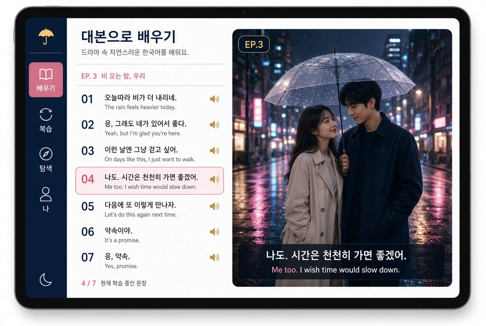

1. 콘셉트

「시리즈 시청형」. 회화 한 편을 드라마 한 회처럼 보여준다. 화면의 주인공은 장면 스틸컷이고, 오프닝 타이틀 카드로 시작해 대사는 화면 하단 자막처럼 붙는다(한글 + 영어 자막 + 로마자 토글). 주제는 시리즈 목록처럼 고정 인물들이 이어지는 연속극 느낌(포장마차·편의점·한강·비 오는 날 우산·첫눈·노래방·회식 등)으로 이어진다. 편을 끝내면 엔딩 크레딧과 다음 회 예고가 나와 “다음 회가 궁금하다”는 이유로 다시 열고 싶게 만든다. 스트릭·포인트 대신 빈도 커버율(아는 단어로 일상 한국어의 ○○%를 이해)이 조용히 오른다. 흰 바탕·남색 #0A2540·인디고 #635BFF는 시리즈 공통으로 두고, 한국 느낌 포인트 색은 단청 적 #E53935과 드라마 골드 #C9A227을 쓴다.

2. 와이어프레임 이미지 (아이패드 가로, 편 재생)

3. 텍스트 레이아웃 (ASCII)

홈 (배우기 첫 화면) — 아이패드 가로

text
복사
복사됨
┌──────────┬─────────────────────────────┬─────────────────────────────┐
│ 레일     │ 시리즈 목록                  │ 오늘의 회                    │
│ 배우기●  │ ┌─서바이벌────────────────┐ │ ┌─EP.1 타이틀 카드────────┐ │
│ 복습     │ │ 3/8회                   │ │ │ [비 오는 거리 스틸]      │ │
│ 탐색     │ └────────────────────────┘ │ │ 다음 회가 궁금해요        │ │
│ 나       │ ┌─친구───────────────────┐ │ └────────────────────────┘ │
│          │ │ 1/6회                   │ │ 커버율 38% · 골드 바         │
│          │ └────────────────────────┘ │ [이어서 보기] [맞춤 회화]    │
└──────────┴─────────────────────────────┴─────────────────────────────┘

주제 (시리즈) 목록

text
복사
복사됨
┌──────────┬─────────────────────────────┬─────────────────────────────┐
│ ← 홈     │ 시리즈 카드 그리드            │ 미리보기 스틸                │
│          │ [서바이벌] [친구] [사랑]     │ ┌────────────────────────┐ │
│          │ [생활] [여행] [문화]         │ │ [한강 야경 스틸]        │ │
│          │ [일] [학업]                  │ │ 고정 인물 A·B            │ │
│          │ 각 카드에 진행 회차          │ └────────────────────────┘ │
└──────────┴─────────────────────────────┴─────────────────────────────┘

편 재생 (드라마 한 회 보기)

text
복사
복사됨
┌──────────┬─────────────────────────────┬─────────────────────────────┐
│ 레일     │ 대사 목록                    │ 장면 스틸 + 자막             │
│ 배우기●  │ 1 비 와요. ✓                │ ┌────────────────────────┐ │
│          │ 2 우산 빌려줄까요? ● (로즈) │ │ [우산 씬 16:9]          │ │
│          │ 3 고마워요.                 │ │ 자막: 우산 빌려줄까요?   │ │
│          │ 4 …                         │ │       Can I lend you…  │ │
│          │                             │ └────────────────────────┘ │
│          │                             │ 한글 / 영어 / 로마자 토글    │
└──────────┴─────────────────────────────┴─────────────────────────────┘
하단: ▶ 재생 · 배속 · 자막 단계

편 끝 (엔딩·다음 회 예고)

text
복사
복사됨
┌─────────────────────────────────────────────────────────────────────┐
│  [엔딩 크레딧 스타일 카드]                                           │
│  EP.3 완주 · 커버율 +2%                                              │
│  다음 회 예고: [첫눈 내리는 한강 스틸]                               │
│  “내일 또 만나요”                                                    │
│  [다음 회 보기]  [카드로 복습]                                       │
└─────────────────────────────────────────────────────────────────────┘

폰 세로 재생

text
복사
복사됨
┌─────────────────────┐
│ EP.3                │
│ ┌─────────────────┐ │
│ │ [장면 스틸 크게]│ │
│ │                 │ │
│ │ 자막 바          │ │
│ └─────────────────┘ │
│ [▶] 1.0x  자막      │
│ 대사 리스트 (하단   │
│ 시트 또는 스와이프) │
└─────────────────────┘

4. 토큰 · 주요 컴포넌트

토큰	값	용도
배경	#FFFFFF	기본 바탕
남색	#0A2540	본문·아이콘·레일
인디고	#635BFF	선택·링크·진행
단청 적	#E53935	현재 턴·강조·EP 배지
드라마 골드	#C9A227	타이틀 카드·엔딩·커버율 바
글꼴	Pretendard / Noto Sans KR + system	한·영·일·중 길이 대응
모서리	12–16px	카드·스틸 프레임
간격	16 / 24 / 32	레일·칸·카드 여백

주요 컴포넌트

EpisodeTitleCard: 오프닝 타이틀 카드 (EP.n + 시리즈명)
SceneStill: 장면 스틸컷 (주인공, 16:9)
SubtitleBar: 하단 자막 (한글 + 영어 + 로마자 토글)
ScriptList: 왼쪽 대사 목록 (현재 턴 로즈 강조)
SeriesCard: 주제=시리즈 카드 (진행 회차 표시)
NextEpisodeTeaser: 편 끝 다음 회 예고 컷
EndingCredits: 짧은 엔딩 크레딧 + 커버율 변화
CoverageCard: “아는 단어로 일상 한국어 ○○%”
PictureCard: 그림만 앞면인 플래시카드 (구조 동일)
LeitnerDesk: 라이트너 분포 (성과 데스크 내)

5. 일본어 앱 시안 02에서 바꾼 점

만화책 컷·말풍선 → 드라마 장면 스틸 + 하단 자막 방식으로 변경
섬(권) 목록 → 시리즈/채널 목록으로, 고정 인물 연속극 느낌 강화
구리색 포인트 → 단청 적 + 드라마 골드로 한국 분위기 전환
편 끝 “구리 플래시” → 엔딩 크레딧 + 다음 회 예고 한 컷으로 변경
“다음 컷을 넘기고 싶다” → “다음 회가 궁금하다”로 매일 여는 이유 재설정 (커버율은 유지)
---
Grok 프로젝트 「talkverse UXUI ko」 [KU01]+[KU01b](이어 쓰기) 2026-11-02. 이미지 = sian_01.jpg(1168×784).
