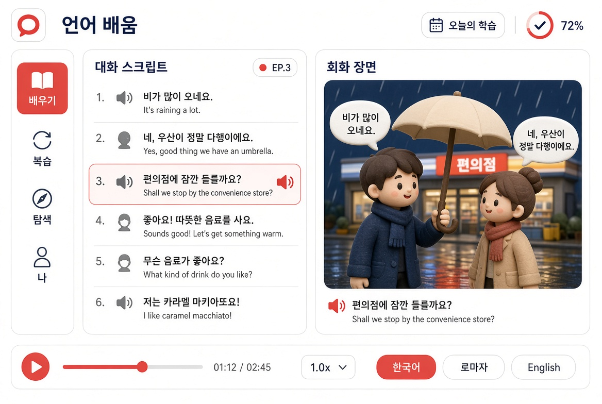

1. 일본어 앱 화면에서 바꾼 점

장면 그림을 실사 대신 부드러운 3D 점토풍으로 유지하되, 비 오는 밤 편의점 앞 우산 하나(K-드라마 상황)로 교체
편 제목 옆에 「EP.3」 배지 추가, 현재 문장 캡션을 드라마 자막처럼 정리
구리색(#B77548)을 단청 적(#C44536)으로 교체(레일 선택·현재 턴 테두리·재생 버튼·슬라이더·선택 칩)
문장은 한국어, 번역은 영어로 변경, 자막 칩을 한국어 / 로마자 / English로 조정
편 끝에는 별도 화면으로 「다음 회 예고」 스틸 + 짧은 크레딧을 두어 연속극 느낌만 보강(재생 화면 배치 자체는 유지)

2. 와이어프레임 이미지 (아이패드 가로, 동일 배치)

3. 포인트 색

단청 적 #C44536
쓰이는 자리: 왼쪽 레일 선택 항목 배경, 가운데 스크립트 현재 턴 테두리·강조, 재생 버튼, 진행 슬라이더 핸들, 자막 칩 중 선택된 항목. (일본어 앱의 구리색과 동일 위치·동일 역할)

[images]
https://assets.grok.com/users/64d3e39f-631e-405e-af90-2a2c64a86b9d/generated/084cde39-f349-44b6-939a-7520cf0bc84d/image.jpg

---
Grok 프로젝트 「talkverse UXUI ko」 [KU02] 2026-11-02 — 일본어앱 시안 02 그림·점토풍 그림 2장 첨부해 같은 배치로 다시 요청(KU01 은 실사·새 배치라 사용자 반려).
