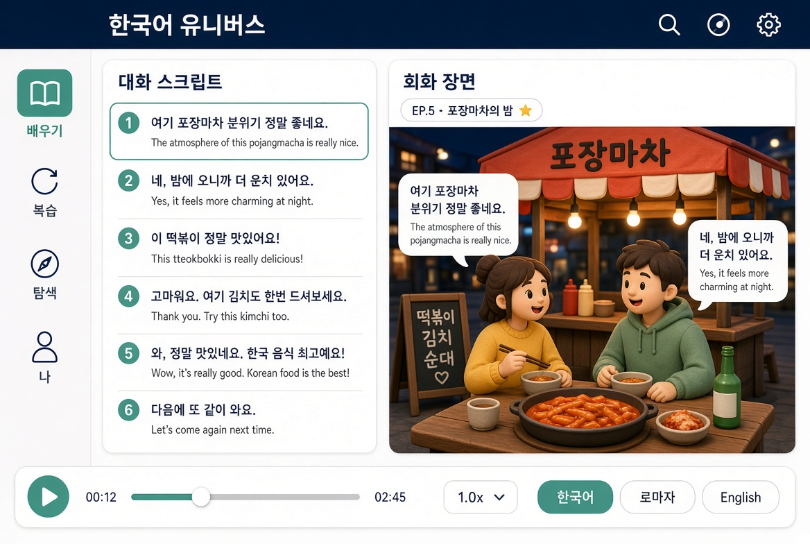

1. KU02 와 다른 점

장면을 비 오는 편의점 우산에서 따뜻한 조명의 밤 포장마차로 변경 (점토풍 유지)
포인트 색을 단청 적에서 청자 비취로 교체
현재 문장 캡션 위에 「EP.5 · 포장마차의 밤」 회차 자막띠 추가
앱바 제목을 「한국어 유니버스」로 고정
전체 분위기를 따뜻한 야간 조명 중심으로 조정 (비·네온 대신 포장마차 불빛)

2. 와이어프레임 이미지 (아이패드 가로, 동일 배치)

3. 포인트 색

청자 비취 #3D8B7A
쓰이는 자리: 왼쪽 레일 선택 항목 배경, 가운데 스크립트 현재 턴 테두리·강조, 재생 버튼, 진행 슬라이더 핸들, 자막 칩 중 선택된 항목. (일본어 앱 구리색과 동일 위치·동일 역할)

---
Grok 프로젝트 「talkverse UXUI ko」 [KU03] 2026-11-02 — 사용자 "시안 하나 더". KU02 와 같은 배치·점토풍, 다른 장면·색.
