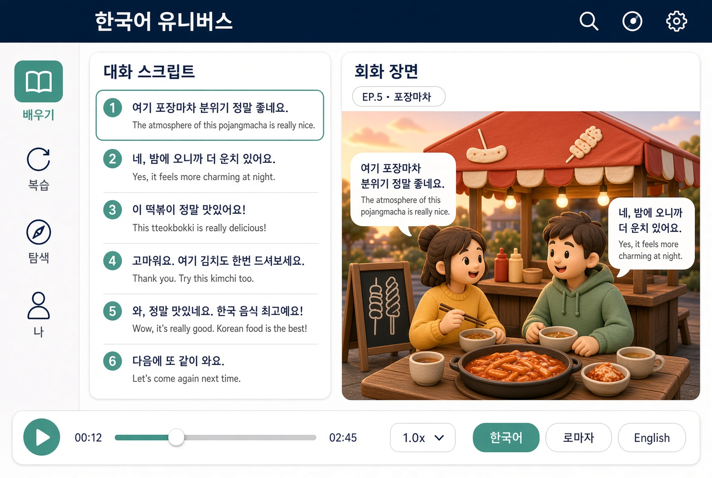

1. 바꾼 점

장면 배경: 어두운 밤 → 밝은 늦은 오후·해 질 녘 직전(파스텔 하늘·따뜻한 햇살·부드러운 그림자)
스타일: 점토/펠트 인형 톤(둥근 얼굴·몸, 따뜻한 조명, 부드러운 질감)으로 재구성
그림 안 글자 전부 제거: 천막 간판·메뉴판 글씨를 빼고 떡볶이·어묵 꼬치 그림으로 대체
술병 제거 후 물컵·어묵 국물 컵으로 교체, 회차 띠를 「EP.5 · 포장마차」로 수정 (UI·대사·배치·청자 비취 포인트는 그대로)

2. 와이어프레임 (아이패드 가로, 동일 구도·배치)

---
Grok 「talkverse UXUI ko」 [KU04] 2026-11-02 — 사용자 "03 괜찮네, 밝은 느낌 주는 배경으로". 03 배치·청자 비취 그대로, 장면만 밝은 오후·점토 톤·그림 안 글자 없음·술병 제거.
